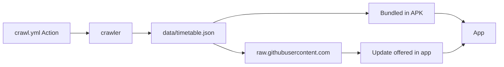

<p align="center">
  
</p>

<h1 align="center">Train Lanka</h1>

<p align="center">
  Fast, offline Sri Lankan train timetables for Android
</p>

<p align="center">
  <a href="https://github.com/MithunWijayasiri/TrainLanka/actions/workflows/app.yml"></a>
  <a href="https://github.com/MithunWijayasiri/TrainLanka/actions/workflows/crawl.yml"></a>
  <br>
  <a href="https://kotlinlang.org"></a>
  <a href="https://developer.android.com/jetpack/compose"></a>
  <a href="https://developer.android.com"></a>
</p>

Train Lanka shows Sri Lankan train timetables and nothing else: no booking, no live tracking, no fares. The whole timetable ships inside the app, so it works offline from the very first launch.

## What it does

- **Search by route.** Pick a from and to station and swap them with one tap. The station picker is grouped by province, and search matches station names and aliases (typing "Pettah" finds Colombo Fort). It forgives typos too, so "Gampha" still finds Gampaha.
- **Upcoming trains first.** Results show only trains that have yet to leave, with a hero card for the next one ("in 12 min"). "Show N earlier trains" reveals the ones that have already departed. After the last train of the day, a "No more trains today" divider is followed by tomorrow's trains.
- **Any day.** Choose Today, Tomorrow, or any date.
- **Full journey view.** Tap a train to see all its stops, with your segment highlighted.
- **Starred and recent routes.** Star the routes you use most and reorder them on the home screen. Recent routes appear there too.
- **Nearest station.** Tap the button to get the closest station from a single GPS fix. Location is read only on that tap, never on start and never in the background.
- **Home-screen widget.** A 4×2 widget shows the next three departures for your first starred route.
- **Settings.** Light, Dark or System theme, 12H or 24H time, and a manual check for timetable updates.

Timetables are filtered by weekday only. Poya and public-holiday schedules may differ.

Requires Android 10 (API 29) or newer. English only for now.

## Install

There is no GitHub release yet.

**Option 1 (recommended): download a CI build.**

1. Open the [App checks workflow](https://github.com/MithunWijayasiri/TrainLanka/actions/workflows/app.yml) and pick a successful run.
2. Download the `train-lanka-apk` artifact. This needs a GitHub sign-in, and artifacts expire after 90 days.
3. Unzip it and sideload the APK.

> [!NOTE]
> The APK is signed with a debug key. It is meant for sideloading only, not for the Play Store.

<details>
<summary><b>Option 2: build from source</b></summary>

<br>

You need JDK 17 and the Android SDK. Set `sdk.dir` in `local.properties`, then run:

```sh
./gradlew :app:assembleRelease
```

The APK is written to `app/build/outputs/apk/release/app-release.apk`.

</details>

## How it works



A GitHub Action (`.github/workflows/crawl.yml`) runs the crawler every Monday at 02:00 Asia/Colombo, and can also be started manually. The crawler reads public timetable pages and commits `data/timetable.json` only when something changed. The app bundles that file, so it works offline immediately.

Once a day the app checks in the background for newer timetable data at `https://raw.githubusercontent.com/MithunWijayasiri/TrainLanka/master/data/timetable.json`. If there is one, it offers an Update button. Nothing is applied until you tap it.

Station provinces come from geoBoundaries ADM1 boundaries, which are derived from OpenStreetMap.

## Development

Repo layout:

| Path | What it is |
| --- | --- |
| `app/` | Android app (Kotlin, Jetpack Compose) |
| `crawler/` | Node + TypeScript crawler (Node 22.18 or newer) |
| `data/timetable.json` | Generated timetable. Don't edit by hand. |
| `data/stations-extra.json` | Hand-kept aliases and province/coordinate overrides |

Run the crawler from `crawler/` with `npm run crawl`. Its typecheck is `npm run typecheck`.

Pull requests run the same checks CI does:

```sh
./gradlew ktlintCheck :app:lintRelease :app:assembleRelease
```

ktlint uses a baseline (`app/config/ktlint/baseline.xml`), so only new code is checked. `./gradlew ktlintFormat` fixes formatting automatically.

## Credits

- Province boundaries: © OpenStreetMap contributors, geoBoundaries.
- Font: Atkinson Hyperlegible, under the SIL Open Font License. The license is shipped in `app/licenses/`.

## Disclaimer

Train Lanka is not affiliated with Sri Lanka Railways. Times may be wrong or outdated, so please confirm with Sri Lanka Railways (hotline 1971) before you travel.
